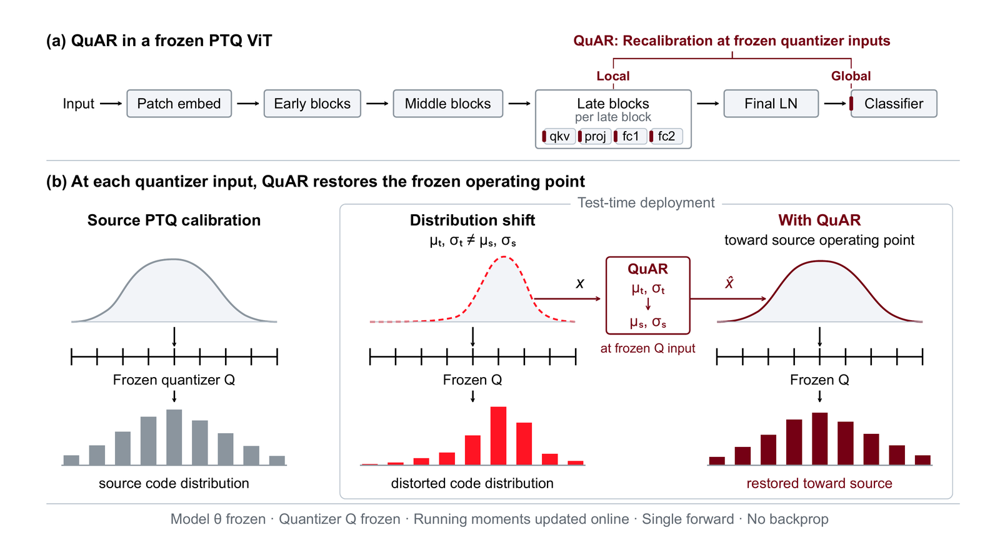
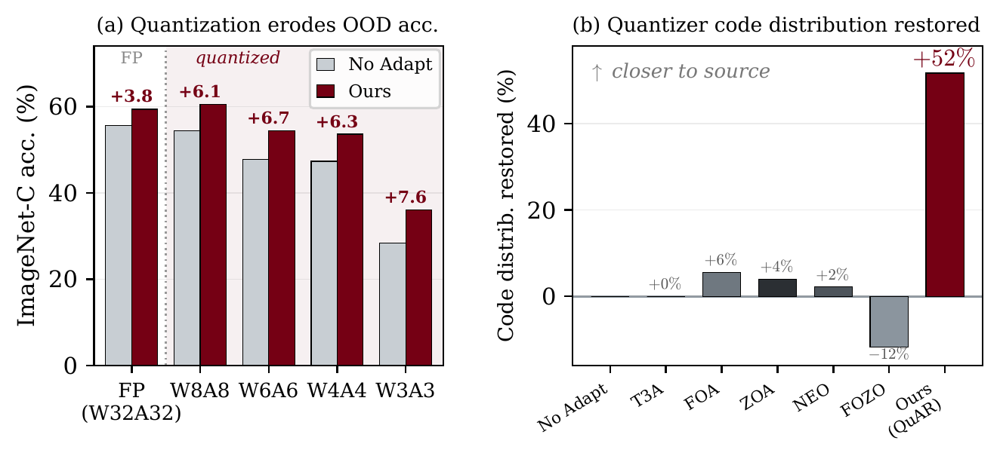

# QuAR: Quantizer-Aligned Recalibration

Single-pass test-time adaptation for quantized vision transformers: no backpropagation, no
parameter updates, one forward pass.

Code for **Test-Time Adaptation of Quantized ViTs via Single-Pass Quantizer-Aligned
Recalibration**, by Hyeongheon Cha, Young D. Kwon and Sung-Ju Lee.

## Method



Under distribution shift the activations entering a frozen quantizer drift, so the quantizer
sees a different code distribution than it was calibrated for. QuAR corrects the tensor the
quantizer reads, mapping the running per-channel statistics of the test stream back toward the
source calibration:

```
x̂ = (1 − λ)·x + λ·[ (x − μ_t)·σ_s / (σ_t + ε) + μ_s ]
```

`μ_s, σ_s` are frozen source moments, `μ_t, σ_t` the running (cumulative) moments of the test
stream, `λ = 0.5`. A local branch applies this at the quantizer inputs of blocks 8–11
({qkv, proj, fc1, fc2}), a global branch at the head input. One configuration everywhere.

## Results



Quantization costs more than precision alone: unadapted ViT-B falls from 55.6 to 28.4 top-1 as it
goes from full precision to W3A3, and QuAR's gain grows as precision drops. It is the only method
here that moves the quantizer's code distribution back toward the source.

ImageNet-C (severity 5, 15 corruptions), quantized ViT-B/16, mean top-1 over 3 seeds. W4A8 is the
asymmetric deployment format (4-bit weights, 8-bit activations).

| Method | W3A3 | W4A4 | W6A6 | W4A8 | W8A8 | Fwd | Upd. params |
|---|---|---|---|---|---|---|---|
| No Adapt | 28.35 | 47.30 | 47.69 | 54.12 | 54.36 | 1 | 0 |
| T3A | 28.49 | 47.42 | 47.79 | 53.74 | 54.16 | 1 | 0 |
| FOA | 31.52 | 50.25 | 50.39 | 57.55 | 57.85 | 2 | 2.3K |
| ZOA | 31.45 | 50.87 | 51.37 | 58.10 | 58.16 | 2 | ≈25K |
| NEO | 31.91 | 50.29 | 51.35 | 58.01 | 58.09 | 1 | 0 |
| FOZO | 31.98 | 50.09 | 49.78 | 57.88 | 57.74 | 2 | 2.3K |
| **QuAR** | **35.98** | **53.58** | **54.35** | **60.11** | **60.44** | **1** | **0** |

One fixed configuration carries the rest, with no per-dataset or per-backbone tuning:

- **Continual.** Over 10 rounds x 15 corruptions with state carried throughout, best in every
  round at both bit-widths and essentially flat, 35.6-35.8 at W3A3 and 53.9-54.0 at W6A6.
- **Non-i.i.d. label shift.** Most accurate at every imbalance ratio from 1 to 5e5, leading by
  1.7-2.7 points, and stable across the sweep (54.55 to 54.73).
- **Other shifts.** Strongest at every bit-width on ImageNet-C-bar, ImageNet-Sketch, ImageNet-3DCC
  and DomainNet-126, within 0.7 points of the best on ImageNet-R, and ahead on CIFAR-10/100-C by
  0.8 to 3.7 points.
- **Other backbones.** At W6A6, +6.6, +6.0 and +6.2 over No Adapt on ViT-B, DeiT-B and ViT-S, with
  seed std no worse than 0.06; on a convolutional ResNet-50, 31.40 against NEO's 30.79 and No
  Adapt's 30.12.
- **Cost.** One forward pass, no parameter writes, 170 KB of state, and at least 46% less latency
  than the two-forward FOA, FOZO and ZOA.

## Running it

```bash
conda env create -f environment.yml    # environment.lock.yml is the exact capture
conda activate quar

python main.py --algorithm quar \
  --quant --quant_w_bit 6 --quant_a_bit 6 --ptq_checkpoint checkpoints/ptq4vit_w6a6_vitb.pt \
  --data $DATA --data_corruption $DATA_C --level 5 --corruption gaussian_noise \
  --imagenet_5k_eval --batch_size 64
```

`--algorithm quar` is the deployed configuration (both branches, cumulative estimator, λ = 0.5,
clamp) and derives the source-statistics paths from the bit-width; explicit flags still win.
Quantization is simulated in PyTorch (weights and activations are quantized in the forward pass; no
integer kernels run): PTQ4ViT for W6A6/W8A8, AdaLog for W3A3/W4A4/W4A8, MQBench for ResNet-50.

## Data and inputs

| Dataset | How the launchers find it | Layout / preparation |
|---|---|---|
| ImageNet validation | `DATA` | `Data/CLS-LOC/<class>/`; the RobustBench 5k subset is selected by `robustbench/data/imagenet_test_image_ids.txt` |
| ImageNet-C | `DATA_C` | `<corruption>/<severity>/<class>/`, severity 5 |
| ImageNet-R, ImageNet-Sketch | `DATA_R`, `DATA_SKETCH` | official releases |
| ImageNet-C-bar | `DATA_CBAR` | generated from clean ImageNet: `scripts/gen_cbar_parallel.sh`, then `scripts/finalize_cbar.sh` (needs the `augmentation-corruption` checkout) |
| ImageNet-3DCC | `DATA_3DCC` | official 224x224 release in the ImageNet-C layout |
| CIFAR-10-C, CIFAR-100-C | `DATA_CIFAR10`, `DATA_CIFAR10_C`, `DATA_CIFAR100`, `DATA_CIFAR100_C` | clean set and severity-5 corruptions written by `tools/prep/export_cifar_imagefolder.py` |
| DomainNet-126 | `DATA_DN126` (source domain, real), `DATA_DN126_C` (target domains `dn_{clipart,painting,sketch}`) | written by `tools/prep/build_domainnet126_imagefolder.py` from the DomainNet cleaned folders and the AdaContrast lists |

```bash
export DATA=/path/to/imagenet/Data/CLS-LOC  DATA_C=/path/to/imagenet-c
export DATA_R=... DATA_SKETCH=... DATA_CBAR=... DATA_3DCC=...     # generalization appendix only
export DATA_CIFAR10=... DATA_CIFAR10_C=... DATA_CIFAR100=... DATA_CIFAR100_C=... DATA_DN126=... DATA_DN126_C=...
```

Launchers locate the repository from their own path; `PY` selects the interpreter (default
`python3`); `/path/to/data` in a launcher is a placeholder.

**Source models.** ViT-B/16 (augreg), DeiT-B and ViT-S from timm; CIFAR-10/100 ViT-B/16 from the
public Hugging Face checkpoints converted by `tools/models/convert_hf_vit_to_timm.py`; DomainNet-126
ViT-B/16 fine-tuned on the real domain by `tools/prep/finetune_vit_imagefolder.py`.

**Source statistics** (`stats/`, shipped, 79 files, ~20 MB). To rebuild one pair:
`tools/stats/build_qac_stats.py` (local branch) and `tools/stats/build_cls_stats.py` (global branch), e.g.
`python tools/stats/build_qac_stats.py --data $DATA --quant --quant_w_bit 6 --quant_a_bit 6 --quar_local_scope all --max_batches 200 --output stats/qac_stats_w6a6_all_layers_seed0.pt`.
ZOA and FOZO statistics are built by their launchers on first use.

**Quantized checkpoints** (`checkpoints/`, not in git). `artifacts/MANIFEST.tsv` lists the 30 files the
launchers expect, with SHA-256 and the builder that produces each:

| Kind | Builder |
|---|---|
| PTQ4ViT ViT-B / DeiT-B / ViT-S (W3A3 to W8A8, W4A8) | `tools/stats/build_qac_stats.py --save_ptq_fullnet`, fixed 32-image calibration set |
| AdaLog ViT-B (W3A3, W4A4, W4A8, W6A6, W8A8) | public [AdaLog](https://github.com/GoatWu/AdaLog) release |
| CIFAR / DomainNet PTQ4ViT and AdaLog models | `scripts/run_bench_queue.sh` phase 0, `tools/stats/build_adalog_ckpt.py` |
| ResNet-50 (GroupNorm and BatchNorm, MQBench W6A6) | `tools/stats/build_resnet_mqbench.py` |

`tools/fetch_artifacts.sh` checks `checkpoints/` against the manifest and downloads what is missing
from [Hyeongheon/QuAR-checkpoints](https://huggingface.co/Hyeongheon/QuAR-checkpoints):

```bash
bash tools/fetch_artifacts.sh            # all of them
bash tools/fetch_artifacts.sh --only w6a6  # one bit-width
```

Every file is checked against its SHA-256 before it is kept. The AdaLog checkpoints and the two
CIFAR ViTs are not redistributed here; the script prints where to get them. Set
`ARTIFACT_BASE_URL` to download from somewhere else.

## Layout

```
main.py          entry point
scripts/         campaign launchers; scripts/paper/ one entry point per main-text table (PRINT_ONLY=1 prints the published values)
tools/           stats/ builders, tables/ generators, analysis/ diagnostics, prep/ data and models
jetson/          on-device latency measurement
tta_library/     QuAR and the baselines
quant_library/   PTQ4ViT and AdaLog quantizers
stats/           frozen source statistics (shipped)
checkpoints/     quantized models (rebuilt or fetched; artifacts/MANIFEST.tsv)
```

## Baselines and licences

T3A, FOA, ZOA, FOZO and NEO (backprop-free) and TENT, EATA, SAR and SPA (backprop-based) run from
their official code and hyperparameters, with a straight-through estimator where a method needs
gradients through the frozen quantized graph (`tta_library/`). AQR has no public code and is
re-implemented from its paper (`tta_library/aqr.py`).

This repository is built on the FOZO codebase (MIT), whose copyright notice is kept in `LICENSE`.
Third-party code carried here, each with its licence alongside:

- AdaLog (Apache-2.0), `quant_library/adalog`, from github.com/GoatWu/AdaLog at 75a57d2; `utils/wrap_net.py`
  is modified and `configs/w4a8.py`, `configs/8bit.py`, `utils/__init__.py` are added (marked in their headers)
- SAR (BSD-3-Clause), `tta_library/sar_official/{tent,eata,sar,sam}.py`, from github.com/mr-eggplant/SAR at 20f6e24, unmodified
- ZOA (MIT), `models/zoa_resnet.py`, from github.com/mala-lab/ZOA at 48305fb, unmodified

Also uses PTQ4ViT, MQBench and RobustBench.

## Citation

```bibtex
@article{cha2026quar,
  title   = {Test-Time Adaptation of Quantized {ViTs} via Single-Pass Quantizer-Aligned Recalibration},
  author  = {Cha, Hyeongheon and Kwon, Young D. and Lee, Sung-Ju},
  journal = {arXiv preprint},
  year    = {2026}
}
```
